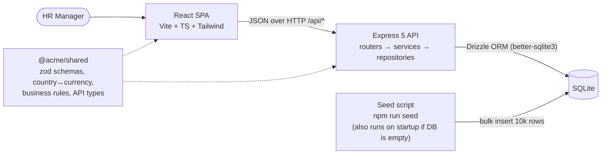
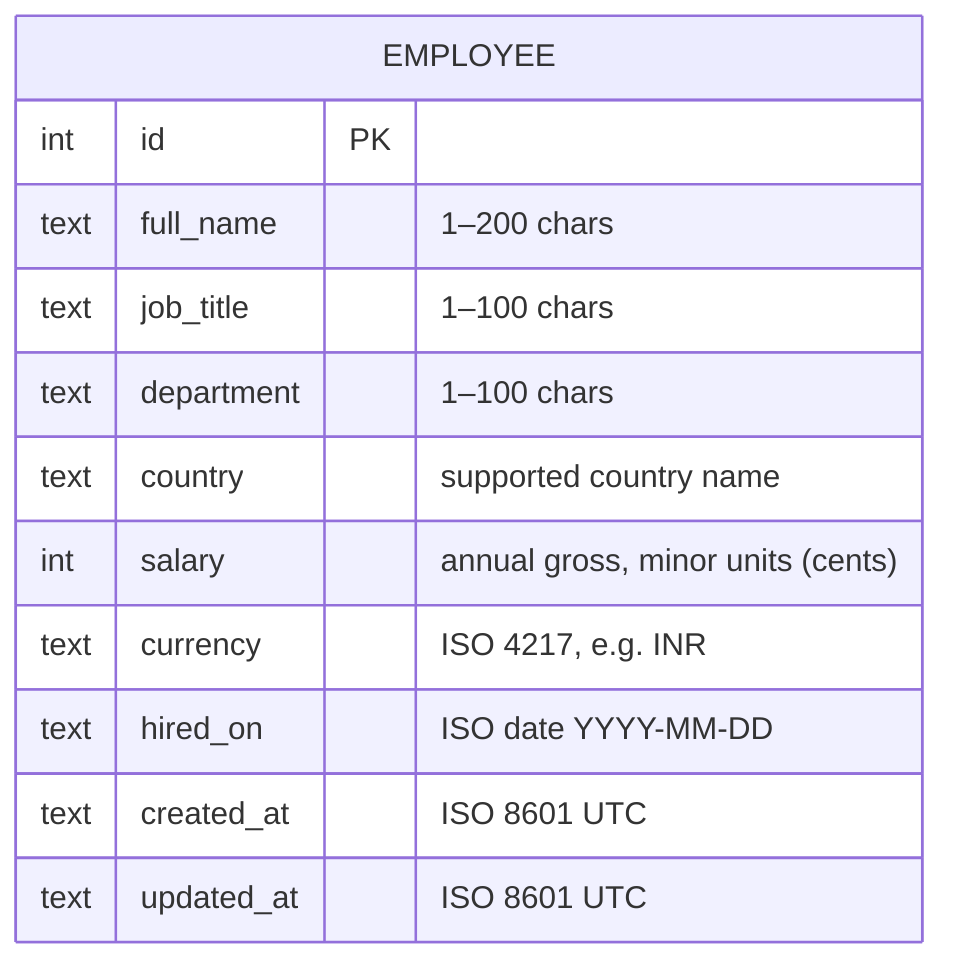
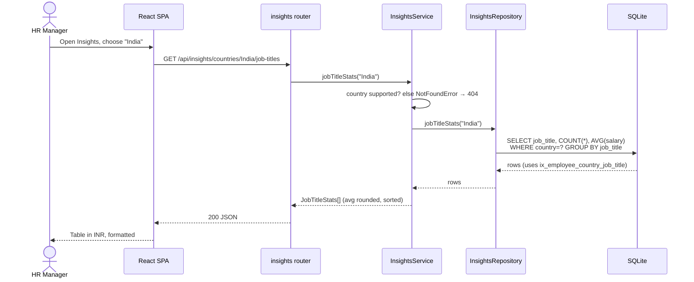

# Architecture

## System



The repo is an npm workspace with three packages: `shared`, `backend` and `frontend`. **`@acme/shared` is the single source of truth for the API contract.** The backend validates requests with its zod schemas and rules, and the frontend form runs the same rules for instant feedback. A rule can't drift between client and server (see ADR-2).

Locally, Vite proxies `/api` to the backend, so there's one origin. When deployed, the SPA is a static build on Vercel and calls the API on Render via `VITE_API_BASE_URL`. The backend only allows origins listed in `CORS_ORIGINS`. See [deployment.md](deployment.md).

## Data model



The table is defined once in Drizzle (`backend/src/db/schema.ts`). `drizzle-kit generate` produces the SQL migration in `backend/drizzle/`, which is committed and applied on startup and in every test.

Supported countries and their currencies live in one map in `@acme/shared` (`COUNTRY_CURRENCY`, e.g. `India → INR`), with each currency's minor-unit digits (`JPY = 0`, others `2`). The seed, the API validation and the form options all read from it.

### Indexes

| Index | Serves | Reason |
|---|---|---|
| `ix_employee_country` | List filter by country | The most common filter. Per-country insights also group on it. |
| `ix_employee_job_title` | List filter by job title alone | Job title is filtered without a country more often than you'd expect (e.g. "all Engineers"). |
| `ix_employee_country_job_title` | Job-title insights within a country, combined filters | Covers `WHERE country = ? GROUP BY job_title` without a separate sort step. |

Notes:
- The composite index's leftmost column is `country`, so `ix_employee_country` is technically redundant. It's kept for clarity and costs very little at 10,000 rows. It's the first candidate to drop.
- Name search uses `LIKE '%term%'`, which can't use a B-tree index. Scanning 10,000 rows takes about a millisecond in SQLite. If the table grew a lot, the next step would be an FTS5 index.
- `department` isn't indexed: it has few distinct values and is filtered less often.

## Layering

```
shared/src/          zod schemas, country↔currency, business rules, response types (used by both sides)
backend/src/
  routers/           HTTP only: parse params with zod, call one service function, send JSON
  http/              error middleware: domain errors → status codes, one error shape
  services/          business rules (via shared), not-found handling, rounding/shaping of insights
  repositories/      the only Drizzle queries: CRUD, filtered pages, GROUP BY aggregations
  db/                Drizzle table, connection, migrations
```

Why:
- **Testability.** Services are tested against an in-memory SQLite database without HTTP. Routers get a thin layer of Supertest API tests.
- **One place per concern.** "Currency must match country" is written once in `@acme/shared` and enforced by the service. The form reuses it.
- **Swappable storage.** Only repositories know about SQL, so moving to Postgres touches that layer and the driver.
- Each layer depends only on the one below it. Services throw domain errors (`NotFoundError`, `DomainValidationError`) and never touch `req`/`res`.
- The app is built by `createApp({ db, corsOrigins, today })`, so tests inject an in-memory DB and a fixed clock. No module-level singletons.

## API contract

Base path: `/api`. Money is always returned as `{ salary: int (minor units), currency: "INR" }`, and the UI formats it with `Intl.NumberFormat`.

| Method | Path | Params / body | Response | Status |
|---|---|---|---|---|
| GET | `/employees` | `page` (≥1, default 1), `page_size` (1–100, default 25), `search`, `country`, `job_title`, `department`, `sort` (`full_name`\|`salary`\|`hired_on`\|`country`\|`job_title`, default `full_name`), `order` (`asc`\|`desc`) | `{ items: Employee[], total, page, page_size }` | 200, 422 |
| GET | `/employees/:id` | — | `Employee` | 200, 404 |
| POST | `/employees` | `EmployeeInput` | `Employee` | 201, 422 |
| PUT | `/employees/:id` | `EmployeeInput` (full replace) | `Employee` | 200, 404, 422 |
| DELETE | `/employees/:id` | — | empty | 204, 404 |
| GET | `/meta/options` | — | `{ countries: [{ name, currency }], job_titles: string[], departments: string[] }` | 200 |
| GET | `/insights/summary` | — | `{ headcount, country_count, department_count }` | 200 |
| GET | `/insights/countries` | — | `[{ country, currency, headcount, min_salary, max_salary, avg_salary }]` | 200 |
| GET | `/insights/countries/:country/job-titles` | — | `[{ job_title, headcount, avg_salary }]` (sorted by `avg_salary` desc) | 200, 404 (unsupported country) |
| GET | `/health` | — | `{ status: "ok" }` | 200 |

`EmployeeInput` = `{ full_name, job_title, department, country, salary, currency, hired_on }`. `Employee` = `EmployeeInput` plus `id`, `created_at` and `updated_at`. `avg_salary` is rounded half-up to whole minor units.

**Errors** always have one shape: `{ "error": { "message": string, "fields"?: { [field]: string } } }`. A 422 fills `fields` so the form can show each message next to its input. Unknown routes return 404 and unexpected failures return 500 with a generic message (details are logged, not leaked).

## Sequence: HR manager views insights for a country



## Validation rules

Shape rules live in the zod `employeeInputSchema` and business rules in `employeeRuleErrors()`, both in `@acme/shared`. The backend is authoritative; the frontend runs the same code for instant feedback.

| Field | Rule |
|---|---|
| `full_name` | Required, trimmed, 1–200 chars |
| `job_title`, `department` | Required, trimmed, 1–100 chars |
| `country` | Required, must be in `COUNTRY_CURRENCY` |
| `currency` | Required, uppercase ISO 4217, must equal `COUNTRY_CURRENCY[country]` |
| `salary` | Required integer (minor units), `> 0` and `≤ 10^12` (guards against typos; well inside `Number.MAX_SAFE_INTEGER`) |
| `hired_on` | Required `YYYY-MM-DD` date, not in the future, not before 1950-01-01 |
| List params | `page ≥ 1`, `1 ≤ page_size ≤ 100`, `sort` and `order` must be from the allowed values (unknown values → 422, never passed into SQL) |
